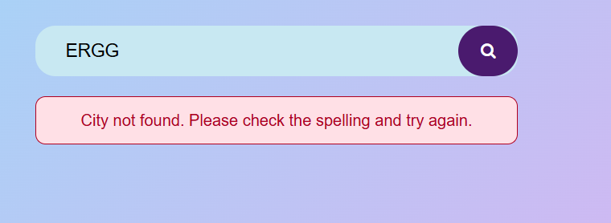
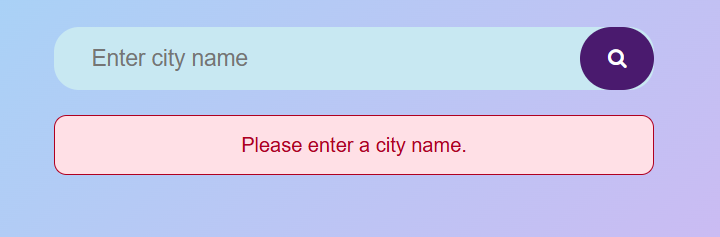
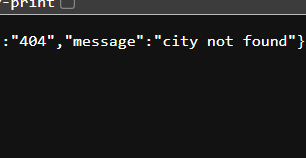
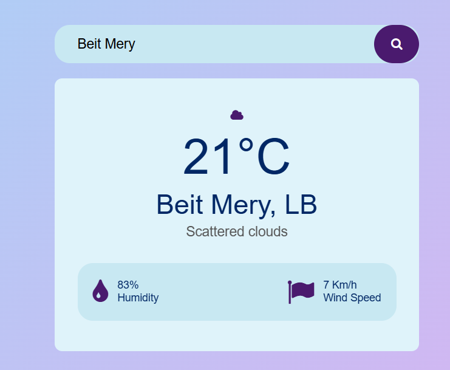
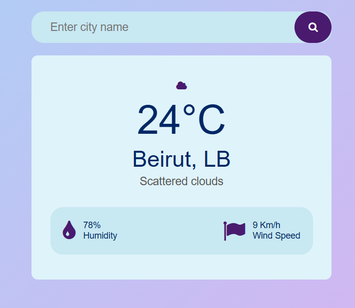

# Weather Website

This project is a small weather application built with HTML, CSS, and JavaScript. It fetches real-time data from the OpenWeatherMap API and displays the current weather for a city entered by the user.

## Project Goal

The app allows the user to type a city name, click the search button, and instantly see the current weather conditions, including:
- temperature
- city and country
- weather description
- humidity
- wind speed
- a matching weather icon

The page also loads a default city (Beirut) when it opens, so the user sees weather data immediately.

## Main Files

### `index.html`
This file contains the structure of the page.

It includes:
- the search bar
- the city input field
- the search button
- the loading message
- the error message
- the weather card with temperature, city name, description, humidity, and wind speed

A Font Awesome CDN link is added so icons such as search, cloud, humidity, and wind can be displayed.

### `styles/style.css`
This file handles the visual design of the app.

It includes:
- page background and layout
- search bar styling
- loading style
- error message style
- weather card styling
- icon design
- responsive rules for mobile screens

The CSS hides the loading and error messages by default and shows them only when JavaScript triggers them.

### `script.js`
This file contains the main logic of the app.

It does the following:
- creates the API URL
- retrieves the HTML elements with `document.getElementById()` and `document.querySelector()`
- disables the search button while a request is being processed
- shows a loading message while waiting for the response
- displays an error if the city is empty, invalid, or missing data
- handles API status codes such as 404, 401, and 429
- converts the API response into usable information for the page
- updates the text and icons on the screen
- listens for user actions such as button click and Enter key press

The app also converts wind speed from m/s to km/h to make it easier for the user to read.

### `config.js`
This file stores the API key used to access OpenWeatherMap.

The comments explain that:
- the key is private
- it should not be uploaded to GitHub
- it is stored in a file excluded from version control using `.gitignore`

### `config.example.js`
This file is a template for the real configuration file.

It tells the developer to copy it into `config.js` and replace the placeholder key with a real OpenWeatherMap API key.

## How the App Works

1. The user enters a city name into the input field.
2. The app checks whether the value is empty.
3. If the API key is missing, it shows an error message.
4. The app sends a request to the weather API.
5. If the response is successful, it displays the weather information.
6. If there is a problem, it shows a message such as:
   - city not found
   - invalid API key
   - network error
   - rate limit reached
7. The search button is temporarily disabled while loading to prevent repeated requests.

## Security

The project keeps the API key private and does not upload it to GitHub.

This is important because if someone else gets access to the API key, they could use it for their own requests.

## Setup

1. Create an account on OpenWeatherMap: https://openweathermap.org/
2. Log in to your account.
3. Go to the "My API keys" section in your profile.
4. Copy your API key.
5. Create a file named `config.js` in the root folder of the project.
6. Paste the key in this file.
7. Open `index.html` in your browser.

Example:

```js
const API_KEY = "YOUR_API_KEY_HERE";
```

Do not commit or upload `config.js` to GitHub. Keep the key in a local file and make sure it is ignored by `.gitignore`.

## Notes

This project is a basic front-end weather app used to practice:
- JavaScript DOM manipulation
- using `fetch()` to call an API
- handling asynchronous operations
- updating the user interface dynamically
- displaying loading and error states
- building a responsive website

## Screenshots

The project includes screenshots showing the app in use.

To avoid exposing API keys, the screenshots used in the README were reviewed and only safe examples were kept.








## Technologies Used

- HTML
- CSS
- JavaScript
- OpenWeatherMap API
- Font Awesome
